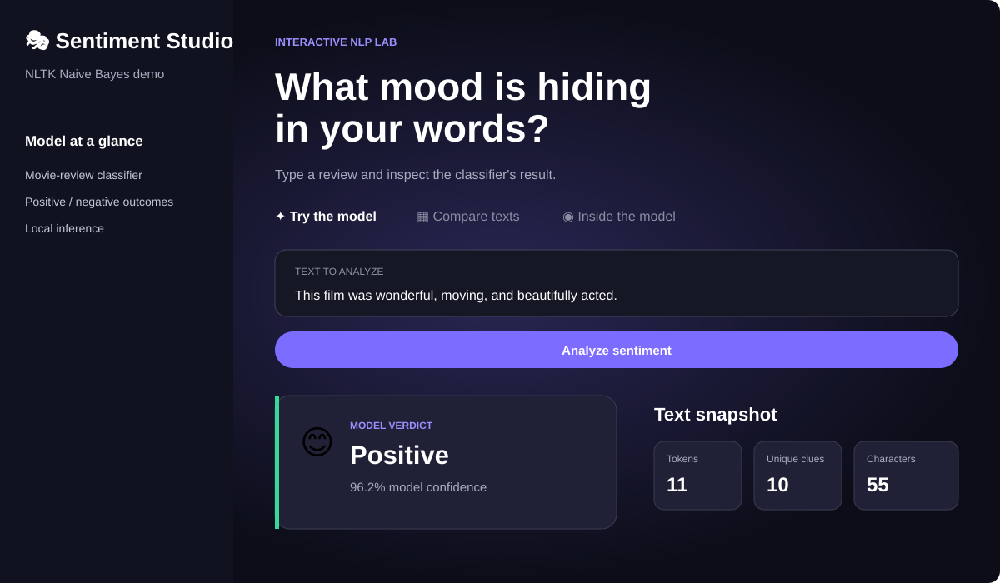
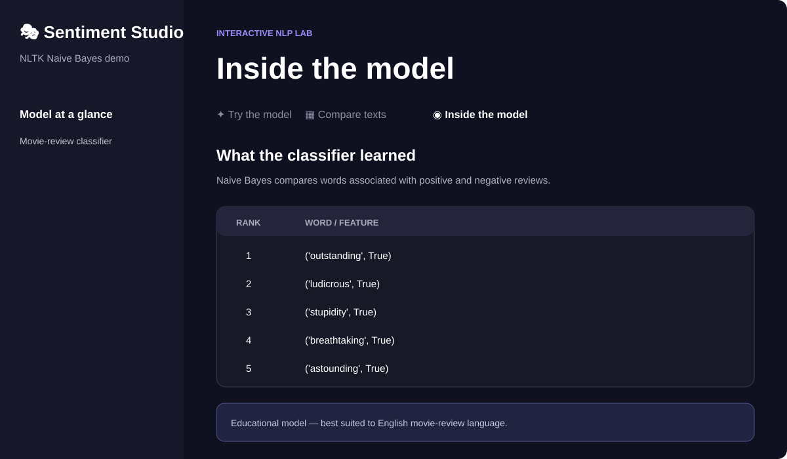

<div align="center">

# 🎭 Sentiment Analysis on Text

**An interactive and explainable sentiment classifier built with NLTK, Naive Bayes, and Streamlit.**

[](https://github.com/forva2025/Sentiment_Analysis_on_text)
[](https://python.org)
[](https://streamlit.io)
[](https://nltk.org)
[](#how-the-model-works)
[](#features)
[](LICENSE)
[](https://github.com/forva2025/Sentiment_Analysis_on_text/commits/main)
[](https://github.com/forva2025/Sentiment_Analysis_on_text)
[](https://github.com/forva2025/Sentiment_Analysis_on_text/issues)
[](#contributing)

[Features](#features) · [Installation](#installation) · [Usage](#using-the-application) · [Model](#how-the-model-works) · [Limitations](#limitations)

</div>

## Overview

This project trains a binary sentiment classifier on NLTK's `movie_reviews` corpus and presents it through a polished Streamlit interface. Visitors can enter English review-style text and see whether the saved model considers it **positive** or **negative**, together with its probability estimate and the features it received.

Inference runs locally: entered text is not sent to an external prediction API. This is an educational classical-NLP project, not a moderation or high-stakes decision system.

## Application screenshots

### Single-text analysis



### Model insights



## Features

- Instant positive/negative classification
- Per-class probability breakdown and readable confidence card
- Token, unique-feature, and character statistics
- Exact token inspection
- Positive, negative, and mixed example prompts
- Batch comparison of up to 50 newline-separated texts
- Most-informative-feature explorer
- Local cached loading of `sentiment_model.joblib`
- Responsive custom Streamlit theme
- No runtime corpus download in the UI

## Project structure

```text
Sentiment_Analysis_on_text/
├── app.py                    # Streamlit UI and inference logic
├── sentiment.py              # Training, evaluation, and model export
├── sentiment_model.joblib    # Serialized NLTK classifier
├── requirements.txt          # Python dependencies
├── docs/screenshots/         # README UI captures
├── LICENSE                   # MIT license
└── README.md
```

## Requirements

- Python 3.10 or newer
- `pip`
- Internet access for initial dependency/corpus installation
- No GPU required

## Installation

```bash
git clone https://github.com/forva2025/Sentiment_Analysis_on_text.git
cd Sentiment_Analysis_on_text
python -m venv .venv
```

Activate the environment on Windows PowerShell:

```powershell
.\.venv\Scripts\Activate.ps1
```

Or on macOS/Linux:

```bash
source .venv/bin/activate
```

Install the dependencies:

```bash
python -m pip install --upgrade pip
python -m pip install -r requirements.txt
```

## Using the application

```bash
python -m streamlit run app.py
```

Streamlit normally opens automatically. Otherwise visit `http://localhost:8501`.

1. Open **Try the model**.
2. Enter English text or choose an example.
3. Select **Analyze sentiment**.
4. Review the prediction, confidence, probabilities, and statistics.
5. Use **Compare texts** for one-review-per-line batch analysis.
6. Open **Inside the model** to inspect learned features and limitations.

The first load may take several seconds while the 5.8 MB classifier is read into memory. Streamlit caches it for later interactions.

## Training the model

The trained model is included. To replace it with a newly trained version:

```bash
python sentiment.py
```

The script downloads the NLTK resources, loads and shuffles 2,000 labeled movie reviews, turns every document into Boolean word-presence features, trains on 1,600 reviews, tests on the remaining 400, prints accuracy and informative features, and writes `sentiment_model.joblib`.

> `random.shuffle()` currently has no fixed seed, so the split, model, and accuracy can vary. Set a seed before shuffling when reproducibility matters.

## How the model works

```text
Input text
    ↓
Word and punctuation tokenization
    ↓
Boolean features: {token: True}
    ↓
NLTK Naive Bayes classifier
    ↓
Positive and negative probabilities
    ↓
Highest-probability label
```

This is a bag-of-words model. Each distinct token records presence or absence; frequency, order, grammar, and broader context are not represented directly.

## Use the model from Python

```python
import joblib
from nltk.tokenize import wordpunct_tokenize

classifier = joblib.load("sentiment_model.joblib")
text = "The performances were wonderful and the ending was brilliant."
features = {token: True for token in wordpunct_tokenize(text)}
distribution = classifier.prob_classify(features)

print("Prediction:", classifier.classify(features))
for label in classifier.labels():
    print(label, distribution.prob(label))
```

## Limitations

- The training domain is movie reviews; other domains may perform worse.
- Only positive and negative labels exist—there is no neutral class.
- Sarcasm, irony, negation, slang, misspellings, and mixed emotion are difficult.
- Word order and repeated-word frequency are ignored.
- Probability is a model estimate, not certainty.
- The corpus may contain historical language and inherited biases.
- Do not use this model for consequential decisions about people.

## Troubleshooting

**The model cannot be loaded:** keep `sentiment_model.joblib` beside `app.py` and install `requirements.txt`.

**Port 8501 is busy:** use `python -m streamlit run app.py --server.port 8502`.

**NLTK data is missing during training:** run `python -m nltk.downloader movie_reviews punkt stopwords`.

## Roadmap

- Add neutral/mixed sentiment
- Report precision, recall, F1, and a confusion matrix
- Make training deterministic
- Add automated tests and continuous integration
- Compare Naive Bayes with transformer models
- Add downloadable batch results

## Contributing

Contributions are welcome. Fork the repository, create a focused branch, test your changes, and open a pull request describing the motivation and behavior. Do not commit virtual environments, secrets, caches, or downloaded corpus data.

## License and acknowledgements

Distributed under the [MIT License](LICENSE). Copyright © 2026 Ochiria Elias Onyait.

Thanks to [NLTK](https://nltk.org), [Streamlit](https://streamlit.io), [Joblib](https://joblib.readthedocs.io), and [Pandas](https://pandas.pydata.org).

---

<div align="center">Built as part of the <strong>30 Projects in 30 Days of AI Development Bootcamp</strong>.</div>
